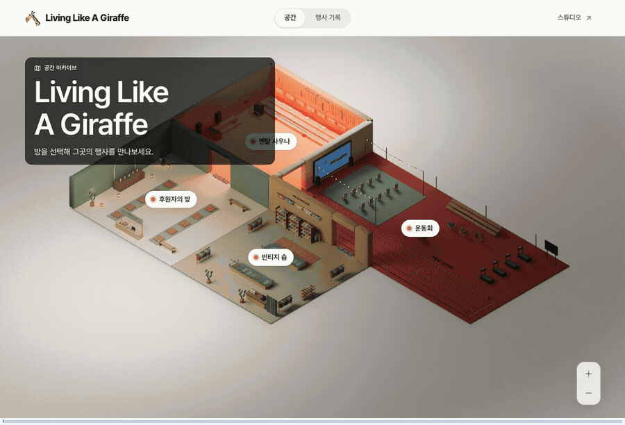
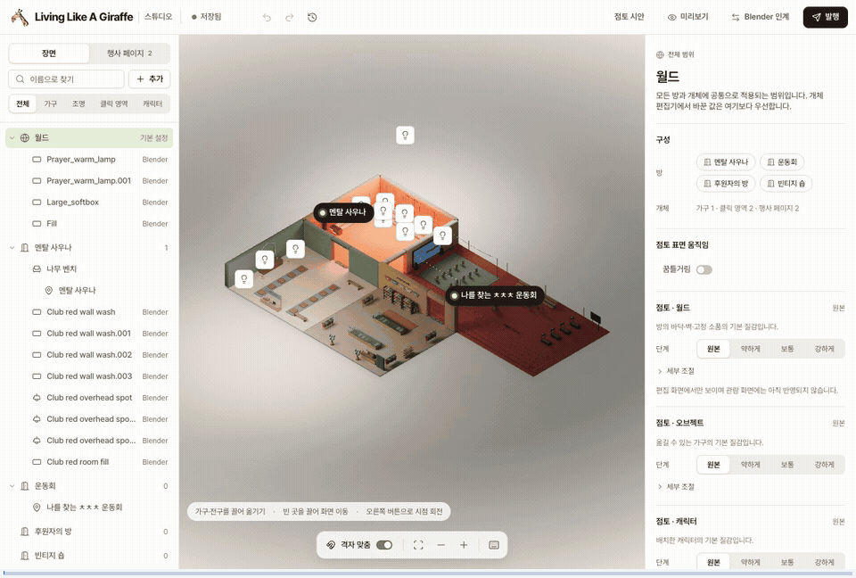
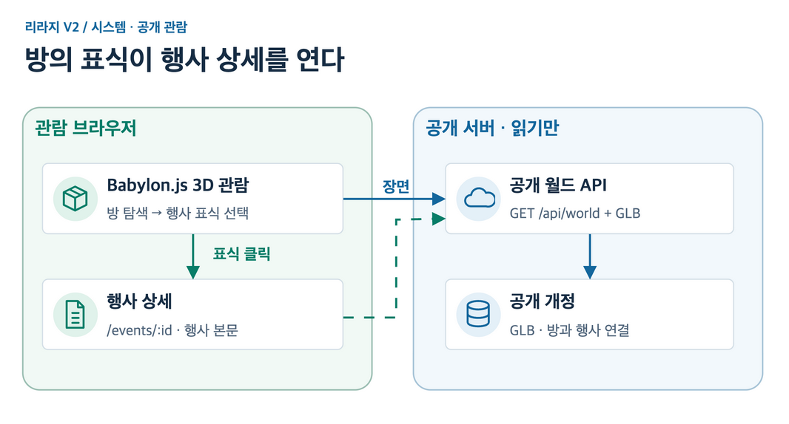
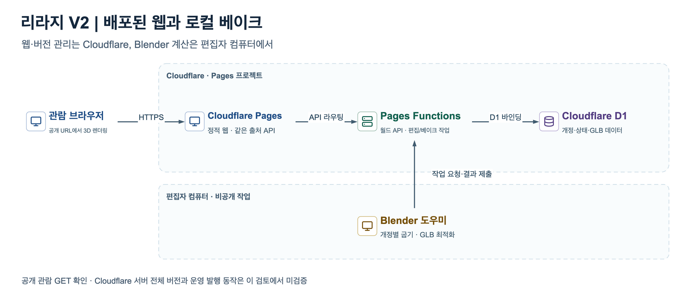
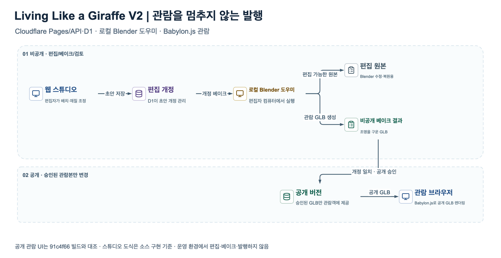

# Living Like a Giraffe V2

## 개요

리라지의 전시 공간과 그곳에서 열린 행사를 함께 탐색하는 **웹 3D 아카이브**다. 관람객은 전체 공간에서 방을 골라 둘러보고, 방 안의 표식을 눌러 행사 기록을 읽는다. 편집자는 별도 스튜디오에서 장면을 수정하고, 새 조명을 구운 결과를 검토한 뒤 관람본을 교체한다.

[3D 공간 둘러보기](https://living-like-a-giraffe.pages.dev/) · [행사 기록 바로 보기](https://living-like-a-giraffe.pages.dev/events)

## 프로젝트 정보와 담당 범위

| 항목 | 내용 |
|---|---|
| 프로젝트 | Living Like a Giraffe V2 · 개인 프로젝트 |
| 사용 대상 | 공간과 행사 기록을 찾아보는 관람객, 장면을 수정하고 공개하는 편집자 |
| 주요 기술 | JavaScript, Babylon.js, Vite, Blender, Cloudflare Pages · D1 |

### 담당 범위

- Blender에서 리라지 v06 월드 원본 팩 제작
- 전체 공간과 개별 방을 오가는 카메라 이동, 방 안 행사 표식과 행사 상세 페이지 연결
- 웹 스튜디오의 편집·검토 흐름과 Blender 인계, 편집 원본과 관람용 GLB를 분리하는 발행 구조 설계·구현

## 문제 정의

행사 목록만으로는 **어느 공간에서 어떤 행사가 열렸는지** 알아보기 어렵다. 공간을 먼저 둘러보는 관람객에게는 방 안에서 행사 기록으로 들어가는 길을 제공하고, 글만 보고 싶은 관람객은 3D 화면을 거치지 않도록 행사 목록을 따로 뒀다.

편집자는 같은 공간에서 조명과 가구 배치를 바꿔야 한다. 저장 즉시 바뀐 장면을 보여주면 조명이 맞는지 확인하는 중간 결과도 방문자에게 공개된다. 그래서 **수정 사항을 저장하는 시점과 관람본을 교체하는 시점**을 분리했다.

## 주요 사용 흐름

### 관람객: 전체 공간에서 방을 찾아 행사 기록 읽기



전체 공간에서 ‘멘탈 사우나’를 선택한 뒤 방 안의 표식을 누르면 행사 카드가 열린다. ‘행사 자세히 보기’에서 사진과 본문까지 읽을 수 있다.

[전체 공간](docs/portfolio-readme/assets/visitor-world.png) · [멘탈 사우나 방](docs/portfolio-readme/assets/visitor-sauna.png) · [행사 본문](docs/portfolio-readme/assets/visitor-event-detail.png)

### 기록 독자: 3D 공간을 거치지 않고 행사 찾기

공간을 둘러보지 않아도 상단 [행사 기록](https://living-like-a-giraffe.pages.dev/events)에서 글을 고를 수 있다. 각 기록에 주소가 있으므로 [멘탈 사우나 기록](https://living-like-a-giraffe.pages.dev/events/mental-sauna)처럼 행사 페이지를 바로 공유할 수 있다.

[행사 기록 목록 화면](docs/portfolio-readme/assets/visitor-event-archive.png)

### 공간 편집자: 가구 위치 바꾸고 초안 미리보기



사우나 나무 벤치의 X 위치를 바꾸면 초안이 저장된다. ‘배치 미리보기’에서 사우나 방을 다시 열어 바뀐 배치를 확인한다. 공개 장면은 그대로다.

[벤치 편집 화면](docs/portfolio-readme/assets/studio-draft.png) · [배치 미리보기](docs/portfolio-readme/assets/studio-preview.png)

### 발행 담당자: 조명을 구워 비공개로 검토하고 공개하기

초안을 기준으로 편집자 컴퓨터의 Blender 도우미가 조명을 굽고 관람에 쓸 GLB를 만든다. 담당자는 비공개 결과에서 베이크된 빛과 장면을 확인한 뒤 관람본을 교체한다. 배치 미리보기는 편집 중의 배치를 확인하는 화면이고, 이 단계의 미리보기는 관람본에 쓸 최종 빛까지 확인하는 화면이다.

[개정별 발행 워크플로](#워크플로우-초안에서-공개까지)

### Blender 제작자: 원본을 편집한 뒤 웹 초안으로 인계

스튜디오에서 현재 개정의 전체 Blender 파일을 내려받아 벽이나 재질을 수정한 다음 다시 올린다. 내려받은 뒤 웹에서 별도로 바꾼 가구 배치와 비교해 함께 반영하고, 같은 가구를 양쪽에서 다르게 옮겼다면 사용할 위치를 선택한다. 정리한 결과는 다음 편집 개정으로 이어진다.

[원본과 관람용 장면을 나눈 이유](#전체-blender-원본과-관람용-장면은-서로-다른-파일로-관리)

## 아키텍처

### 시스템 구조: 방에서 행사 글까지



[편집 원본](docs/portfolio-readme/assets/giraffe-system.drawio)

### 인프라: 공개 웹과 편집자 컴퓨터



[편집 원본](docs/portfolio-readme/assets/giraffe-environment.drawio)

| 구성 | 역할 |
|---|---|
| 관람 웹 | Babylon.js가 공개 개정의 GLB와 행사 연결 정보를 읽어 3D 공간을 렌더링한다. |
| 편집 웹 | 초안을 편집하고 저장한다. ‘비공개 미리보기’ 경로에서 결과를 검토한 뒤 공개를 승인한다. |
| Cloudflare Pages · D1 | Pages가 웹과 API를 제공한다. D1은 초안·검토 결과·현재 공개 버전을 관리한다. |
| 편집자 컴퓨터 | 연결된 도우미가 Blender로 조명을 굽고 웹용 GLB를 최적화해 결과를 보낸다. |

### 워크플로우: 초안에서 공개까지



[편집 원본](docs/portfolio-readme/assets/publish-flow.drawio)

예를 들어 사우나 벤치를 옮기면 **변경 저장 → 해당 개정 베이크 → 비공개 결과 확인 → 공개** 순서로 진행할 수 있다. 발행 전까지 방문자는 이전 방을 본다.

## 기술적 의사결정

### 전체 Blender 원본과 관람용 장면은 서로 다른 파일로 관리

처음 검토한 방법은 웹용 모델을 그대로 편집한 뒤 Blender로 되돌리는 것이었다. 하지만 휴대폰에서 보려고 가볍게 만든 GLB에서는 제작에 필요한 장면 계층이나 원래 재질과 조명을 되살리기 어렵다. 방과 가구 이름을 바꾸거나 모델을 다시 내보내더라도 행사 표식은 같은 대상을 따라가야 했다.

그래서 전체 `.blend`를 보존하고 개정별로 관람 모델을 만든다. 웹 편집기는 위치·회전·행사 연결을 가구와 방의 고유 ID에 묶고, 파일을 다시 가져올 때는 **내려받은 시점·현재 웹 초안·수정된 Blender 파일**을 비교한다. 예를 들어 제작자가 사우나 벽의 색을 바꾸고 웹에서 의자를 옮겼다면 두 변경을 함께 반영한다. 같은 의자를 서로 다른 위치로 옮겼다면 어느 위치를 쓸지 선택한다. GLB를 역변환하는 대신 원본을 이어 쓰는 만큼, 배치와 원본을 같은 개정으로 보관하는 일이 중요해졌다.

### 편집하는 동안의 빛과 관람객에게 보여줄 빛을 나눔

스튜디오에서 의자를 끄는 동안에는 새 위치의 색과 빛을 바로 봐야 한다. 반대로 모든 방문자 브라우저에서 전시 조명의 간접광과 그림자를 다시 계산할 필요는 없다. 편집용 모델은 방마다 바닥 위 1m에 6×6으로 배치한 지점에서 여섯 방향의 빛을 미리 측정해 둔다. 가구를 옮기면 가까운 지점들의 값을 섞어 현재 자리의 빛을 즉시 보여준다.

관람본은 위치가 정해진 벽·바닥·가구의 빛과 색을 Blender Cycles에서 굽고, 제작 장면의 노출과 색 변환을 적용한 sRGB 텍스처를 사용한다. 유리처럼 시점에 따라 보이는 모습이 달라지는 재질은 실시간 렌더링을 유지한다. 편집 중에는 이동과 직접광을 확인하고, 새 가구가 벽에 비추는 색이나 바뀐 조명의 간접광은 별도 관람 미리보기에서 확인한다. 비용이 큰 계산을 발행 시점에 맡기면서도 최종 모습을 공개 전에 보고 결정할 수 있다.

### 발행 개정은 클라우드가 관리하고, Blender는 편집자의 컴퓨터에서 실행

운영자 맥을 원격으로 연결해 계속 쓰거나, 클라우드에서 Blender를 돌리는 안을 검토했다. 첫 안은 운영자 컴퓨터가 켜져 있어야 하고, 두 번째 안은 클라우드가 별도 Blender 실행 환경과 작업을 관리해야 했다. 실제로는 Cloudflare Pages가 스튜디오와 관람 웹을 제공하고 D1이 개정을 관리하며, 베이크와 GLB 최적화는 작업을 요청한 편집자의 Blender 도우미에서 실행한다.

도우미가 받는 권한은 한 개정의 파일을 읽고 결과를 올리는 작업에만 쓰인다. 그사이 다른 편집자가 저장하면 이전 개정의 결과로 새 관람본을 덮을 수 없다. 검토한 결과를 공개할 때는 방문자가 읽는 개정 포인터를 한 번에 바꾸므로, 작업 중이거나 도우미 연결이 끊겨도 방문자는 직전 공개본을 계속 볼 수 있다. 편집자는 처음에 도우미를 설치해야 하지만 운영자가 자리를 비워도 본인 컴퓨터에서 발행을 준비할 수 있다.

## 이용하기

[3D 전시 열기](https://living-like-a-giraffe.pages.dev/)에서 공간과 행사 표식을 탐색할 수 있다. 글만 보고 싶다면 [행사 기록](https://living-like-a-giraffe.pages.dev/events)으로 바로 들어간다.

[로컬 실행 및 구현 근거](docs/portfolio-readme/source/verification.md)

<details>
<summary>기존 설치·개발 안내</summary>

# Living Like a Giraffe V2

리라지의 공간과 행사 기록을 Babylon.js 월드로 다시 만드는 프로젝트다. 프로젝트 폴더에는 월드 원본과 행사 조사 기록, 명세와 설계 결정 도구가 준비되어 있다.

- 모델을 열거나 수정할 때는 [월드 자산](docs/world/README.md)을 확인한다.
- 행사 페이지를 준비할 때는 [행사 자료](docs/events/README.md)에서 출처를 확인한다.
- 화면을 만들거나 고칠 때는 [디자인 시스템](docs/design-system/README.md)의 토큰과 컴포넌트를 쓰고 확장한다.
- 프로젝트 작업을 시작할 때는 [작업 지침](AGENTS.md)을 읽는다.

## 개발 도구

OpenSpec과 adrs가 필요한 환경에서는 아래 명령으로 설치한다. 이 프로젝트는 OpenSpec 1.14.3과 adrs 0.13.0으로 구성했다.

```sh
npm install -g @fission-ai/openspec@1.14.3
brew install adrs
```

프로젝트 루트에서 `openspec list`로 진행 중인 변경을, `adrs list`로 설계 결정을 조회한다. Codex의 프로젝트 MCP 설정은 `adrs`와 `uvx`를 PATH에서 찾는다.

운영 사이트의 편집·발행과 배포 명령은 [클라우드 스튜디오](docs/world/README.md#클라우드-스튜디오)에 있다.

## 로컬 실행

Node 22.17 이상, uv와 macOS에서 프로젝트 루트에서 실행한다. Blender 작업은 독립 Python 환경에 설치되며 별도 애드온이 필요하지 않다.

```sh
npm ci
uv venv --python 3.11 .venv
uv pip install --python .venv/bin/python -r world/requirements.txt
npm run prepare:world
npm run dev
```

관람은 http://127.0.0.1:4173, PC 편집은 `/studio`에서 연다. 기존 두 행사 페이지는 `/events`에서 3D 초기화와 별도로 열린다. 첫 시작 시 관리자 키가 로컬 `.world/admin-key`에 생성된다. 운영자가 별도로 지정할 때는 `RIRAGI_ADMIN_KEY`를 사용한다. `.world`에는 비공개 전체 원본·초안·인계 기준·공개 버전이 포함되므로 이 디렉터리 전체를 함께 백업한다.

`npm run build && npm start`로 빌드 결과를 확인한다. `npm test`는 배치 검증·병합·되돌리기를 검사한다. `npm run test:world`는 준비한 원본을 임시 저장소에 복사해 실제 Blender 다운로드·재업로드·베이크·복원을 검사한다. 서버는 루프백 주소에 바인딩한다.

브라우저 흐름은 로컬 Chrome이 설치된 환경에서 `npm run build && npm run test:browser`로 검증한다. 모바일 기기 설정을 적용한 Chrome 테스트와 실제 iOS Safari·Android 기기의 화질·성능 측정은 구분한다.

`.venv/bin/python tests/asset-contract.py`는 회전한 방과 같은 재질의 바닥·가구를 검사한다. 로컬 사이트가 실행 중일 때 `node tests/render-batches.mjs`는 서로 호환되는 가구 두 개와 다른 가구 한 개를 그려 실제 WebGL 호출 횟수와 개별 클릭 연결을 확인한다.

</details>
