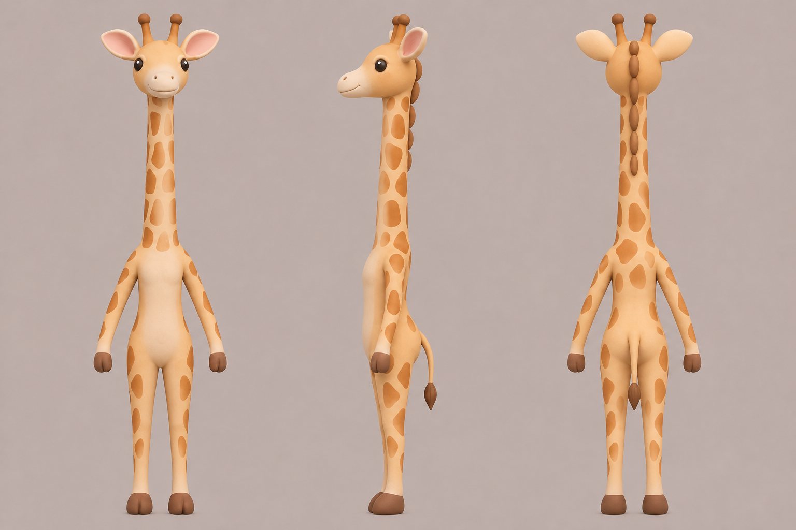

# 리라지 두발 클레이 기린 모델링 가이드

리라지는 **손으로 빚은 클레이 기린**이다. [의상 원화](../../assets-source/characters/riragi-clay/references/riragi-biped-wardrobe-concept.png)는 얼굴의 인상과 옷차림의 기준이고, 아래 **첫 번째 맨몸 3면도**는 옷 안에 들어갈 몸의 기준이다. 정면의 허리·허벅지 너비와 측면의 가슴·엉덩이 깊이는 이 시트에서 읽는다.

**3D 생성기에 이미지 한 장을 넣을 때**는 [사선 전신 PNG](../../assets-source/characters/riragi-clay/references/riragi-biped-redesign-three-quarter.png)를 쓴다. 양팔과 몸통 사이, 두 발 사이로 배경이 보여 각 부분을 구별하기 쉽다. **Blender에서 비율을 맞출 때**는 위 3면도를 쓴다. 정면과 측면 뷰포트에 각각 기준 이미지를 놓고 발바닥 높이와 뿔 끝을 먼저 맞춘다. 시점마다 반점 위치에 차이가 있으므로 턱, 목 밑동, 겨드랑이, 가랑이 높이를 기준으로 두 뷰를 맞춘다. 무늬는 몸이 정해진 뒤 하나의 표면에 칠한다.

## 첫 3면도로 만든 Blender 작업본

[클레이 기린 Blender 파일](../../assets-source/characters/riragi-clay/first-sheet/riragi-first-sheet.blend)을 열면 **01 · 맨몸** 장면의 기본 자세가 보인다. 목·가슴·어깨·팔과 골반·다리는 한 메시로 이어진다. 얼굴, 반점 채색, 둥근 발굽과 첫 3면도 이미지는 파일에 들어 있다. [맨몸 정면·측면·후면 렌더](../../assets-source/characters/riragi-clay/first-sheet/bare-turnaround.png)

Blender 상단의 장면 목록에서 **02 · 셔츠 인사**를 고르면 같은 모델이 아이보리 셔츠를 입고 오른손을 든다. 타임라인을 1프레임으로 옮겨 재생하면 팔을 들어 두 번 흔들고 내린다. 29프레임에서 두 장면을 비교하면 목 밑동과 셔츠 깃, 소매산과 겨드랑이가 같은 자세에서 어떻게 보이는지 확인할 수 있다. [인사 동작 비교](../../assets-source/characters/riragi-clay/first-sheet/greeting.gif) · [목·어깨 확대 렌더](../../assets-source/characters/riragi-clay/first-sheet/greeting-shoulders.png)

두 장면은 `Riragi.Rig`와 **오른손 인사** 액션을 공유한다. 몸의 비율은 리그의 **오브젝트 속성 → 사용자 정의 속성**에서, 셔츠의 몸판과 깃·앞섶·소맷부리는 **03 · 아이보리 셔츠** 컬렉션에서 편집한다.

## 클레이의 형태와 표면

먼저 단색 점토로 정면과 옆면을 맞춘다. 볼과 주둥이, 귓바퀴, 둥근 뿔 끝처럼 손으로 눌러 만든 덩어리가 작은 화면에서도 읽혀야 한다. 몸통은 빛이 넓게 퍼지는 무광으로, 눈은 작은 하이라이트가 생기도록 만든다. 목과 몸의 갈색 반점은 같은 표면에 입히고 손자국은 옆에서 빛을 비췄을 때 가까이에서만 드러날 정도로 얕게 둔다.

기존 [맨몸 Blender 원본](../../assets-source/characters/riragi-clay/riragi-biped.blend)에는 몸·얼굴 채색과 얕은 손자국 노멀 맵(빛에 작은 요철이 보이게 하는 이미지)이 내장되어 있다. 새 몸의 표면 좌표(UV)에 맞춰 반점과 손자국 크기를 조정한다. 몸을 돌렸을 때 무늬가 붙어서 움직이는지, GLB에서도 작은 눈 하이라이트와 몸의 무광이 구분되는지 본다. 얼굴이 움직임을 따라 찌그러지면 리깅 가중치를 보고, 스튜디오의 점토 강도를 바꿀 때만 찌그러지면 얼굴 보호 속성 `_CLAY_PROTECT`를 확인한다. [Blender의 glTF 재질과 노멀 맵](https://docs.blender.org/manual/en/4.5/addons/import_export/scene_gltf2.html#normal-map) · [리라지의 얼굴 보호 속성](../../web/clay-protect-loader.js)

## 1. 재킷 안에 들어갈 어깨와 몸통

- **목과 가슴을 옆에서 먼저 잡는다.** 원화에서 턱 아래부터 셔츠 깃까지 드러난 목이 발바닥에서 뿔 끝까지 높이의 약 3분의 1이다. 목의 중간은 가늘게 두고, 아래쪽 앞선은 윗가슴으로, 뒤선은 등으로 길게 이어 준다. 실제 기린도 목과 가슴의 경계가 고개를 숙이고 드는 움직임에 참여한다. 리라지에서는 이 특징을 밑동에서도 조금 휘는 목으로 표현하는 편이 어울린다. [Müller 등의 기린 목 운동 범위 연구](https://pubmed.ncbi.nlm.nih.gov/33443310/)
- **어깨 폭은 원화의 재킷 안에서 정한다.** 정면에서 목 밑동 양옆으로 짧은 경사를 만들고 그 경사가 끝나는 지점 아래에 위팔을 붙인다. 재킷 바깥 실루엣에는 소매산과 셔츠 두께도 들어간다. 맨몸 단계에서 그 폭을 모두 써버리면 옷을 입힐 때 어깨가 한 번 더 넓어진다. 팔을 조금 벌려 겨드랑이 안쪽 면을 만들고, 팔을 내렸을 때도 어깨가 뾰족하게 솟지 않는지 본다.
- **하체는 첫 3면도의 앞·옆 윤곽을 함께 맞춘다.** 정면에서는 허리가 들어간 지점과 허벅지 위쪽의 가장 넓은 지점을 잡고, 옆에서는 등에서 엉덩이와 허벅지 뒤로 내려오는 곡선을 맞춘다. 꼬리를 잠시 가려 보면 몸의 깊이를 읽기 쉽다. 좌우 고관절은 다리가 시작되는 몸 안에 두고, 앉을 때 앞쪽이 접히고 뒤쪽이 펴질 수 있도록 다리 뿌리에 골반과 허벅지 뼈의 영향을 나눠 칠한다.

이족보행 동물의 옷을 설계한 사례로는 《주토피아》가 있다. 캐릭터 아트 디렉터 코리 로프티스는 바지가 자연스럽게 맞도록 종마다 하체 비율을 조정했다고 설명한다. 리라지에서는 허리띠가 놓일 높이, 두 다리가 갈라지는 지점, 꼬리 트임을 바지 패턴의 기준으로 쓴다. [코리 로프티스 인터뷰의 이족보행 대목](https://www.whiskynsunshine.com/creating-the-citizens-of-zootopia/)

## 2. 목과 팔을 따로 움직여 보기

1. **회색 맨몸에 시험용 뼈대부터 넣는다.** 목 밑동부터 어깨·가슴·등·위팔까지 이어진 표면을 만든다. 이미지에서 생성한 메시를 쓴다면 겨드랑이에 팔과 몸통이 붙었는지, 무릎 안쪽이나 두 다리 사이에 면이 가로질러 생겼는지 확인한다. 붙은 곳을 열고, 관절 주변은 구부러지는 방향으로 여러 줄의 면이 접히고 펴지게 다시 짠다. 특히 목 밑동을 도는 선과 팔이 들어가는 둘레를 감싸는 선이 가슴과 등으로 자연스럽게 이어져야 한다. [Blender 어깨 모델링·리깅 시연, 0분 33초부터](https://www.youtube.com/watch?v=c_XM01I6ed0&t=33s)
2. **목과 팔은 윗가슴에서 각각 출발한다.** 리라지의 기존 골격에는 가슴 위로 세 마디 목과 머리가 이어지고, 양쪽 위팔도 가슴에서 갈라진다. 새 몸을 여기에 맞출 때 목 밑동에는 가슴과 첫 목뼈의 영향을 섞고, 어깨 바깥으로 갈수록 가슴과 위팔의 영향을 섞는다. 이 비율을 칠하는 작업이 *웨이트 페인팅*이다. 고개를 한쪽으로 돌려 반대쪽 소매가 들리는지, 팔을 들어 목 옆이 잡아당겨지는지 각각 살핀다. 팔을 높이 들어 어깨가 꺼지면 위팔 회전 중심과 겨드랑이 안쪽의 가중치부터 고친다. Blender Studio에서는 특정 자세를 보정할 때 셰이프 키도 사용한다. 리라지에서 몸 메시에 셰이프 키가 있으면 현재 GLB 내보내기의 메시 축소 단계가 실패한다. 첫 시제품은 뼈와 가중치로 조정하고, 몸에 보정 키가 꼭 필요해지면 같은 정점 순서를 보존하는 내보내기 경로를 먼저 마련한다. [프로젝트의 GLB 내보내기](../../scripts/export-clay-biped.py) · [Blender Studio의 리깅 제작 방식](https://studio.blender.org/tools/pipeline-overview/rigging)
3. **인사와 걷기로 무게를 확인한다.** 고개를 깊이 숙일 때는 가슴과 목 밑동에서 굽힘을 시작해 중간 목과 머리까지 나눈다. 가볍게 끄덕일 때는 머리 가까운 쪽에 움직임을 더 준다. 걷기에서는 발굽이 바닥을 딛는 순간을 정하고 골반의 높이와 좌우 이동을 맞춘 뒤, 긴 목 끝의 머리가 얼마나 흔들리는지 본다. 발굽이 떠 있거나 머리가 채찍처럼 튀면 접지와 목 회전량을 먼저 다듬는다. [Blender Studio의 포즈별 변형 시험](https://studio.blender.org/training/blender-fundamentals-45-lts/blender_4-5_lts_rigging_weight-painting/)

## 3. 같은 옷을 돌려 입힐 체형 조절

체형을 바꿀 때는 몸 표면뿐 아니라 관절과 옷이 어디로 따라가야 하는지 함께 정한다. 아래는 새 모델을 제작할 때의 조절 기준이다. 프로젝트의 기존 몸통·목·다리·머리 제어는 [체형 처리 코드](../../web/giraffe-proportions.js)에 있다.

| 조절하고 싶은 것 | 움직일 부분 | 비교할 부분 |
| --- | --- | --- |
| 목 길이 | 밑동을 기준으로 중간 목 구간의 길이를 바꾸고 머리와 얼굴 장식을 끝까지 따라 보낸다. | 목 둘레와 셔츠 깃 높이, 머리 크기 |
| 체격 | 가슴·배·골반의 폭과 깊이를 바꾸고 어깨 부착 위치와 위팔 두께, 셔츠·겉옷의 품을 함께 맞춘다. | 팔 길이, 소매산의 위치, 셔츠와 재킷 사이 여유 |
| 머리 크기 | 목 끝과 뒤통수가 만나는 점을 기준으로 머리와 귀·뿔·눈·주둥이의 배치를 함께 조절한다. | 목과 턱 사이가 벌어지는지, 안경다리가 귀에 닿는지 |
| 키 | 허벅지와 종아리 길이에 변화의 대부분을 주고 몸통 세로 길이를 조금 연동하는 프리셋으로 설계한다. 골반 높이와 무릎 위치를 다시 맞춘다. | 딛는 발의 높이와 미끄러짐, 바지 무릎선·밑단, 몸통 조절 때문에 목까지 길어지는지 |

키를 한 번 조절해 다리와 몸통이 함께 변하는 방식은 이번 제안이다. 기본형과 양 끝값을 먼저 정한 뒤, 큰 머리와 짧은 목, 큰 체격과 짧은 다리처럼 서로 간섭하기 쉬운 조합을 옷 입은 상태에서도 시험한다.

## 4. 셔츠 한 벌에서 다른 디자인 만들기

| 기본형 | 살려 둘 기준 | 새 디자인에서 바꿀 곳 |
| --- | --- | --- |
| 상의 | 목둘레, 어깨 끝, 겨드랑이, 허리선 | 깃 모양, 앞여밈의 겹침 폭, 소매·몸판 길이, 품 |
| 하의 | 허리띠, 샅솔기, 꼬리 뿌리, 무릎선 | 허리 높이, 바지통, 기장, 꼬리 트임 |
| 외투 | 셔츠를 입은 어깨선, 소매가 붙는 둘레, 라펠 접힘선 | 라펠 폭, 앞섶의 겹침·벌어짐, 기장, 여유분, 주머니 |
| 액세서리 | 얼굴·귀·가슴 등 부착 위치 | 안경과 귀 장식은 단단하게 고정하고, 넥타이는 매듭을 깃에 맞춘 뒤 긴 끝이 가슴을 따라가게 한다. |

셔츠와 바지를 먼저 맞춘 뒤 **셔츠를 실제로 입힌 상태에서** 외투를 재단한다. 목 밑동을 한 바퀴 도는 깃은 뒤목에서 앞여밈으로 자연스럽게 내려오게 하고, 재킷의 라펠 폭을 바꿀 때는 접힘선을 고정한다. 앞섶을 더 겹치면 단추 위치도 함께 옮긴다. 꼬리 트임은 꼬리가 나오는 높이와 앉을 때 꼬리가 눕는 방향으로 잡는다. Pixar의 의상 재피팅 연구에서도 부위마다 다른 밀착도와 옷의 겹침·솔기·접힘을 각각 보존한다. [Pixar의 체형별 의상 피팅 사례](https://graphics.pixar.com/library//GarmentRefit/paper.pdf)

Blender에서는 몸과 옷이 같은 기본 자세에서 같은 아마추어를 쓰게 한다. 의상에 *Data Transfer*를 걸고 몸의 *Vertex Groups*를 *Nearest Face Interpolated*로 옮기면 몸 표면에서 가까운 면의 가중치를 섞어 시작할 수 있다. 겨드랑이는 소매가 가슴을, 바지 안쪽은 반대 다리를 따라가는 경우가 있어 부위를 나눠 전송하거나 직접 칠한다. 체격을 셰이프 키로 바꾼 부위에는 옷에도 대응하는 핏을 만든다. 가중치 전송은 관절을 따라가는 비율을 복사하는 기능이다. [Blender의 Data Transfer](https://docs.blender.org/manual/en/3.6/modeling/modifiers/modify/data_transfer.html) · [셰이프 키 원리](https://docs.blender.org/manual/en/4.5/animation/shape_keys/introduction.html)

리라지에는 이미 셔츠·재킷·슬랙스 패턴과 라펠 폭·기장·품 프리셋이 있다. 의상 제작의 출발점은 [정장 Blender 원본](../../assets-source/characters/riragi-clay/riragi-biped-suit.blend)과 `make-wardrobe-variant.py`다. 이 경로는 선택한 옷의 셰이프 키를 메시 모양에 구운 뒤 GLB로 내보낸다. 새 몸의 목둘레·어깨·겨드랑이·허리·샅 높이를 확정한 뒤 세 패턴을 한 번씩 다시 피팅하면 다음 의상부터 그 베이스를 쓸 수 있다. 앞섶 겹침처럼 같은 정점으로 만들 수 있는 변화는 의상 셰이프 키로, 새 후드나 지퍼처럼 구조가 달라지는 변화는 교체할 부품으로 만드는 편이 편집하기 쉽다. 앞섶 겹침은 새 베이스에 제안하는 항목이다. [기존 패턴과 지원 조절값](README.md#두발-기린-의상-베이스)

## 첫 시제품의 피팅 순서

| 자세 | 볼 곳 |
| --- | --- |
| 팔을 내린 차렷 → 한 팔을 옆으로 90도 들기 → 머리 위로 인사하기 | 어깨가 목에 빨려 들어가는지, 겨드랑이와 셔츠가 재킷을 뚫는지 |
| 고개 돌리기 → 가슴 쪽으로 숙이기 | 뒤목이 한 점에서 접히는지, 턱이나 넥타이가 깃을 통과하는지 |
| 큰 보폭으로 걷기 → 앉기 | 딛는 발의 미끄러짐, 바지 샅·무릎·꼬리 트임, 긴 외투 자락과 허벅지의 겹침 |

맨몸, 셔츠만 입은 상태, 셔츠와 재킷을 겹친 상태를 같은 각도에서 본다. 처음에는 몸·셔츠·재킷에 서로 다른 단색을 입히면 어느 층이 튀어나왔는지 찾기 쉽다. 최종 확인은 내보낸 GLB로 같은 동작을 재생한다. Blender에서 드라이버나 제약으로 만든 움직임은 배포 파일에 사용할 뼈 변환이나 셰이프 키 값으로 기록해야 한다. [Blender glTF 내보내기](https://docs.blender.org/manual/ko/4.5/addons/import_export/scene_gltf2.html)

두 기준 이미지를 만든 프롬프트

Codex 내장 이미지 생성 도구를 사용했다. 3면도에는 의상 원화를, 사선 전신에는 이 3면도와 의상 원화를 순서대로 첨부했다.

**3면도**

Edit the attached concept art into a professional Blender character modeling turnaround. The LEFT bare-faced suited giraffe is the identity and proportion reference. Under the clothes, design the ONE same appealing slim upright stylized giraffe. Draw three matched full-length orthographic views, left to right: dead straight FRONT (both ears), true 90-degree PROFILE (facing to the left, muzzle in profile, one eye), and dead straight BACK. Each centered in its own equal-width third on a wide landscape canvas. Equal scale, identical neutral relaxed low A-pose in all views, same shoulder/elbow/hip/knee heights and common sole baseline, both ossicone tips and all hooves within frame. Plain seamless light warm gray background, soft diffuse light, barely any floor shadow. No lettering, guides, dividers, props, clothes, accessories, or imitations of clothing edges. A clean art-department reference suitable to isolate each view.
Lock the character of the reference: two small rounded dark-tipped ossicones, broad side-opening ears with soft pink interiors, dark beadlike eyes, rounded pale cream protruding muzzle, tiny nostrils and a quiet closed-mouth smile. Warm ochre/tan matte fine modeling clay, sparse irregular flat caramel giraffe markings. Small low rounded mane along the upper back of the neck in profile/rear. Keep the source's striking proportions: the horn tips to chin are about one sixth of the height; from chin to base of exposed neck about another third of the entire standing height. Slim almost upright long neck; the neck-shoulder transition falls close to halfway up the full figure. Narrow, short, gently rounded upper body, compact shallow pelvis, and trouser-length slim legs to match the source dressing envelope, dark two-toed rounded hoof feet and simple mitten-like two-lobed hoof hands. Keep the soft adult mascot appeal of the original, no bulky baby proportions. Neck has a gently widening root; the back of the neck sweeps gradually into upper back, the front into a softly convex upper chest. Narrow sloping shoulders with clear arm roots lower and lateral to the neck base and soft visible armpits. Smooth continuous animal contours, no human clavicle grooves, pectorals, human navel or human fingers. Two arms and two legs only. Small natural bent elbows, arms separated from torso by clear negative space at 25–30 degrees from vertical, hands below pelvis near upper thighs. Slim separated legs, knees face forward, hooves under hips with stable flat soles. In side/rear show a slender tail rooted at rear pelvis, hanging naturally with a small darker tuft, clear of legs and not wrapping around them. Aim for the same sculpt photographed from 3 cameras; preserve the same markings at corresponding features. Do not make a finished plush toy with seams or a chibi figure.

**사선 전신**

첫 번째 첨부(맨몸 3면도)의 기린 한 마리를 같은 모델 그대로, 3D 생성기에 단독 입력할 세로형 전신 레퍼런스로 그린다. 두 번째 첨부(옷 입은 원화)는 얼굴의 인상과 재질만 참고한다. 카메라는 눈높이를 왜곡하지 않는 평행 투영에 가까운 정면 사선 약 20도. 코가 화면 오른쪽을 향하고 머리와 몸통을 같은 각도로 둔다. 뿔 끝부터 양쪽 발굽까지 한 화면에 크게 담고 모든 끝에 여백을 둔다. 3면도에서 턱·목 밑동·어깨·가랑이·발굽의 높이, 마른 체격, 목과 가슴이 이어지는 실루엣, 귀와 주둥이, 반점 크기를 유지한다. 두 팔을 몸에서 조금 더 벌린 낮은 A 자세로 먼 쪽 겨드랑이와 양손, 두 발굽의 사이가 각각 배경과 분리되어 보이게 한다. 뒤 골반에서 나온 가는 꼬리 끝이 몸 옆으로 약간 보인다. 무광 점토의 따뜻한 색, 부드럽고 고른 조명, 단색 옅은 회색 배경. 그림에 옷, 소품, 글자, 선, 추가 시점이나 다른 기린을 넣지 않는다.

